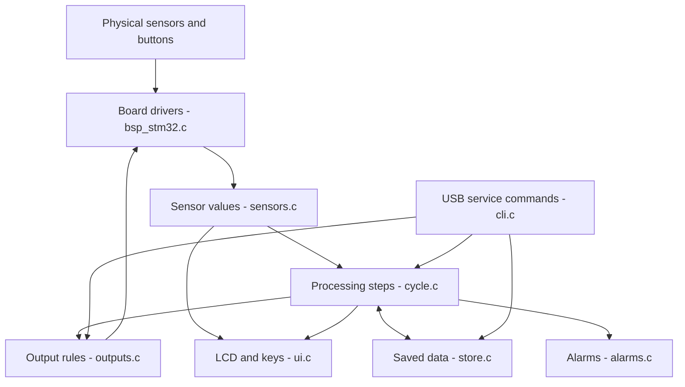

# Diala Firmware Architecture - Explained Simply

This guide is based on the C source in **Diala Firmware v1.2.0**, not on the older README. Start with the [main README](../../README.md) if this is your first time opening the project.

## 1. The big idea

The firmware has **three main jobs**:

1. **Observe:** read the machine's sensors and buttons.
2. **Decide:** choose the current processing step and check whether it can continue safely.
3. **Act and record:** turn valves or the pump on/off, update the display, and save results.



The `bsp.h` interface allows the same application code to run against **real hardware** (`src/bsp/stm32/`) or a **simulated machine** (`src/sim/`).

## 2. What happens after power ON?

**Entry point:** [`src/bsp/stm32/main.c`](../src/bsp/stm32/main.c)

```c
int main(void)
{
    bsp_init();
    app_init();
    for (;;) app_poll();
}
```

| Order | Function | Explanation |
| --- | --- | --- |
| 1 | `bsp_init()` | Configures clocks, GPIO, ADC, UART, LCD, timers, RTC, and watchdogs. |
| 2 | `app_init()` | Loads FRAM settings and calibration; prepares sensors, outputs, cycle engine, UI, USB CLI, and kit test. |
| 3 | `cycle_validate_tables()` | Checks every step table for predefined safety rules. An invalid table stops the application from driving outputs. |
| 4 | `post_start()` / `post_tick()` | Checks firmware image, FRAM, power rails, transducers, load cell, and valve-driver startup condition. |
| 5 | `app_poll()` | Runs continuously for as long as the controller is powered. |

If a stored record shows that a process was running when power disappeared, `app_init()` adds an **aborted** log entry and clears the running record. It does **not** resume the process where it stopped. If the saved state indicates germicide had entered the circuit, the firmware also raises a power-loss warning.

## 3. Does it use an RTOS?

**No.** This is a **bare-metal C11** application. There are no application threads, queues, or RTOS tasks. `app_poll()` checks the current millisecond counter and runs functions when they are due.

| Interval | Main work | Source |
| --- | --- | --- |
| Every 10 ms | Read sensors; update outputs; advance self-test, process, kit test, and alarms | `app.c` |
| Every 10 ms | Read and debounce six keys | `app.c` |
| Every 100 ms | Render/update LCD | `ui.c` |
| About every 100 ms | Kick watchdogs **only if sequencer and UI have run** | `app.c` |
| Every 30 seconds | Reinitialize LCD interface to recover from display glitches | `app.c` |
| About every second | Calculate inlet flow and request/read optional temperature probe | `sensors.c` |

The STM32 hardware UART uses interrupts and a transmit ring buffer. Large `log`, `events`, and `steps` transfers are sent gradually so they do not hold up the processing loop.

## 4. The process engine (`cycle.c`)

Each action is a row in a `step_t` table. Instead of writing a long chain of hard-coded delays, the firmware describes a step using:

- **Name and stage:** what the machine is doing.
- **Valve mask:** which of V1-V10 should be open.
- **Pump command:** whether the dosing pump should run.
- **Exit condition:** what observation means the step is complete.
- **Maximum time:** how long it may take before a timeout/alarm.
- **Flags:** extra rules such as tank access, rinse mode, or leak testing.

Example, simplified from the source:

```c
{ "FILL TANK FOR TCV", 6, V2 | V5, 0,
  EX_TANK_GE, T_CONST, TCV_FILL_TANK_G,
  S(45000), ALM_TIMEOUT, SF_TANK }
```

In plain language: **at stage 6, open V2 and V5 and wait until the tank contains at least the configured weight. If this takes too long, stop and report a timeout.**

### How one step runs

```text
Enter step
   |
   +--> Save start time and starting tank weight
   +--> Check sensors and safety conditions every 10 ms
   +--> Apply the requested valve/pump outputs
   +--> Test the step's completion condition
   |
   +--> Complete: save step measurements -> next step
   |
   `--> Failure: stop outputs -> raise alarm -> recovery only if safe
```

Exit types are defined in [`cycle.h`](../src/app/cycle.h):

| Exit type | Meaning |
| --- | --- |
| `EX_TIME` | Wait for a fixed time. |
| `EX_TANK_LE` / `EX_TANK_GE` | Tank is below/above a target weight. |
| `EX_ADDED` / `EX_DRAWN` | Target weight was added to/removed from the tank. |
| `EX_PBUS_LE` | Pressure reaches a target and remains there for consecutive readings. |
| `EX_LIQUID` | Liquid sensor reports liquid consistently. |
| `EX_READY` | Valve rail and required sensor readings are ready. |

### Main full-reprocessing stages

The **low**, **middle**, and **high flux** programs share one 21-step table. They select different recipe values from `recipes.c`.

| Stage | What the software does |
| --- | --- |
| 1. Self-check | Waits for the rail and required sensors to be ready. |
| 2. Connector check | Checks whether the specified vacuum can be reached. |
| 3. Prepare cleaning solution | Empties tank; doses cleaner; adds water. |
| 4. Clean | Routes cleaner through membrane/top connector paths. |
| 5. Rinse | Flushes blood and dialysate paths. |
| 6. TCV check | Fills tank, empties one path, performs liquid-detection-based draw and measures volume. |
| 7. Leak test | Evacuates circuit, settles pressure, measures vacuum loss. |
| 8. Germicide | Prepares and distributes germicide into the specified paths. |
| 9. Hold/vent | Reports the result and periodically pulses the vent path until completion/acknowledgement. |

**Note:** Stage 9 is managed as a `CY_HOLD` state, not as a row in the 21-step table. `PROG_PRECLEAN` runs the first **10** rows of that table. Disinfection, rinse-out, and service operations have their own smaller tables.

### Main states

| State | Meaning |
| --- | --- |
| `CY_IDLE` | No program running. |
| `CY_RUN` | Executing one of the defined steps. |
| `CY_RECOVER` | Performing a safe recovery action after some errors. |
| `CY_HOLD` | Full reprocessing finished; periodically vents and waits for completion. |
| `CY_DISINF_HOLD` | Disinfection complete; operator is informed of the hold requirement. |
| `CY_STRIP` | Rinse-out completed; waiting for the test-strip answer. |
| `CY_DONE` | Result shown; waits for acknowledgement. |

**Important distinction:** A fault does not always initiate a vent/drain action. Some fault types immediately shut everything down; others attempt a recovery step **only if the rail and outputs are still considered usable**. See `abort_cycle_end()` and `finish_recovery()` in `cycle.c`.

## 5. Recipes (`recipes.c`)

Recipe selection depends on **dialyser type** (low/middle/high flux) and **priming volume**. The code uses lookup-table entries, not a formula that calculates a new recipe from scratch.

Each row stores these targets: cleaning concentrate and water, sterilant and water, and amounts directed into the DI and blood-side paths. The source contains the following programmed gram values:

| Type | Priming volume (ml) | Cleaning: concentrate + water (g) | Germicide: concentrate + water (g) |
| --- | ---: | ---: | ---: |
| Low | 25-80 | 9 + 391 | 17 + 483 |
| Low | 81-250 | 11 + 489 | 17 + 483 |
| Middle | 25-70 | 11 + 489 | 17 + 483 |
| Middle | 71-90 | 16 + 684 | 17 + 483 |
| Middle | 91-250 | 20 + 880 | 17 + 483 |
| High | 25-90 | 16 + 684 | 22 + 678 |
| High | 91-250 | 20 + 880 | 22 + 678 |

These are **code values for engineering review**, not validated chemical-preparation instructions. Do not infer verified chemical strength or reprocessing efficacy from the comments/quantities. See `recipe_find()` and `recipe_disinfect()` for exact selection.

## 6. How TCV and leak testing are calculated

### TCV (Total Cell Volume)

The program records two tank-weight readings and subtracts a calibrated fixed line volume:

```text
TCV (ml, as represented by the firmware)
  = weight before draw - weight after draw - WF
```

`WF` is the saved line-volume calibration from FRAM. Internally values are stored at **0.1-unit precision** (`x10`). On the first use of an ID, the TCV becomes that ID's reference baseline. On later uses, the result is compared with that baseline. The current code passes the TCV check at **80% or more of the baseline**.

### Leak test

The bus is evacuated to the configured vacuum target. After a **1 second settling period**, the firmware saves the starting pressure, waits through the remaining **20 second measurement window**, and calculates:

```text
Vacuum loss = final pressure - settled starting pressure
```

The code compares that loss against a limit selected by dialyser type (low/middle or high). These thresholds are in [`config.h`](../src/app/config.h) and require bench/process validation.

### Daily disinfection and rinse-out

Daily disinfection uses a separate step table and records that **germicide is in the lines**. The RTC tracks a **6-hour hold requirement**, which the rinse-out UI can display as time remaining. In this source version the remaining time is an **operator warning/display**, not a hard program-start lock; release procedures must enforce the approved process.

After rinse-out, the machine asks about the test strip. The firmware clears the saved germicide-in-lines flag only after a **negative** answer; a positive answer starts another rinse-out sequence.

## 7. Sensors -> decisions -> outputs

The application never reads STM32 registers directly. It calls the board support functions defined in [`bsp.h`](../src/bsp/bsp.h):

- [`sensors.c`](../src/app/sensors.c) filters analog readings, converts to engineering units, reads the load cell, counts flow pulses, and reports whether readings are fresh/valid.
- [`cycle.c`](../src/app/cycle.c) uses those measurements to determine the current step and respond to problems.
- [`outputs.c`](../src/app/outputs.c) manages valve-rail startup, valve masks, pump output, periodic refresh, and valve-driver fault monitoring.
- [`bsp_stm32.c`](../src/bsp/stm32/bsp_stm32.c) performs the actual ADC, timer, GPIO, UART, FRAM, LCD, and driver operations.

At startup, the valve rail is kept off. When requested, it has to settle; the firmware resets the driver fault state and checks `nFAULT` before marking the rail ready.

### Safety rules: know where they are enforced

| Protection | Where the code checks it |
| --- | --- |
| Nonzero valve output requires a ready valve rail | `out_set()` in `outputs.c` |
| V5 (tank valve) requires permission for that operation | `out_set()` and step flags |
| V1 and V2 must not be requested together in a *program table* | `cycle_validate_tables()` in `cycle.c` |
| Rinse rows must not open V5 | `cycle_validate_tables()` |
| Process limits, sensor health, pressure loss, tank overfill, dosing stall | `run_tick()` in `cycle.c` |
| Valve `nFAULT` checking | `out_tick()` in `outputs.c` |
| CPU fault immediately removes valve-rail request and pump PWM | Fault handlers in `bsp_stm32.c` |
| Watchdogs require main loop progress | `app_poll()` and `bsp_wdg_kick()` |

A *table validation check* is **not the same as a universal runtime hardware interlock**. In particular, `out_set()` does not independently reject every possible unsafe combination from an arbitrary caller. The predefined program tables and the service interface have additional controls. Recheck all these layers after changes.

Another important behavior: a failed driver fault check on rail-up raises a **warning**, but the code allows a degraded session with ongoing `nFAULT` monitoring disabled for that session. This requires explicit engineering sign-off, not an assumption that the fault is harmless.

## 8. Saving data (`store.c`)

A **64 KB MB85RC512T FRAM** stores values even after power is removed. Main blocks:

| Stored information | Purpose |
| --- | --- |
| Two CRC-protected calibration copies | Scale, pressure offsets, line volume and sensor factors |
| Two CRC-protected settings copies | Service PIN, driver options, time-limit scale, board serial, boot count, etc. |
| Active-run record | Recognizes an interrupted program after reset |
| Kit-test record | Allows the FRAM power-cycle test to resume and preserves results |
| 256 dialyser entries | ID, baseline TCV, type, reuse count |
| Up to 2,082 cycle records | Timestamp, program, result, TCV, leak result, alarms and duration |

The 256-entry dialyser table is also loaded into RAM for fast lookup. The event trace (up to **256 recent events**) is **RAM-only** and resets on reboot; it is not the same as the persistent cycle log.

Records use CRCs to detect corrupted data. Storage layout compatibility matters: do not change packed structures, addresses or CRC positions casually.

## 9. LCD and buttons (`ui.c`)

The six buttons are **START, STOP, MUTE, UP, DOWN, ENTER**. Key presses are debounced in `app.c` and passed to `ui_key()`.

- From the home screen, **UP/DOWN** change the selected program, **START** begins setup, **ENTER** can clear an alarm, and **long ENTER (3 s)** enters service PIN input.
- Patient programs request an **8-digit dialyser ID** and priming-volume information before confirmation.
- During a program, the LCD shows the stage, step name, elapsed time, weight, and pressures.
- **STOP** requests a process abort. **MUTE** silences the buzzer but does not clear an alarm.
- Service screens provide diagnostics, calibration, individual output checks, and service programs.

The kit-test module temporarily takes control of the keypad/LCD while its test is running.

## 10. Where to change something

| Requirement | File/function to inspect first | What else to check |
| --- | --- | --- |
| Adjust a validated numeric threshold | `src/app/config.h` | Matching sensor units, test scenarios and safety review |
| Update approved recipe targets | `src/app/recipes.c` | Program selection, quantities, process validation |
| Change step order or time limit | `src/app/cycle.c` (`*_steps` tables) | `check_cycle_table.py`, boot validation, simulator and hardware tests |
| Change state transitions | `src/app/cycle.c` (`cycle_start`, `run_tick`, `complete_program`, `cycle_tick`) | Abort/recovery and persistence behavior |
| Fix an ADC reading or calibration conversion | `src/app/sensors.c` | `board.h`, real sensor range, calibration |
| Change a microcontroller pin | `src/bsp/stm32/board.h` and `bsp_stm32.c` | Fabricated PCB netlist and `check_pinmap.py` |
| Change LCD text or navigation | `src/app/ui.c` | `check_lcd_text.py`, keypad tests |
| Add a USB command | `src/app/cli.c` | Authorization, non-blocking output and safety behavior |
| Change a warning/alarm | `src/app/alarms.c`, `cycle.c`, `post.c` | Severity, latching and downstream tests |
| Change stored values | `src/app/store.h`, `store.c` | FRAM compatibility/migration and CRC tests |
| Change board test items | `src/app/kittest.c`, `tools/kittest.py` | Physical test instructions, FRAM test record |

**Recommended development order:** locate the owning file -> understand the current behavior -> change only the necessary function -> rerun simulator and source checks -> verify on an isolated test bench -> review and document the measured result.

## 11. What is *not* included in the source package?

The ZIP contains no full external PRD document, clinical validation report, production calibration records, or CMSIS `vendor/` headers. It has encoded PRD references in comments and a truth-table checking script, but the external process specification cannot be independently verified from this ZIP alone.

Continue with [Hardware and pin map](HARDWARE_AND_PINS.md), [Build and testing](BUILD_AND_TESTING.md), or [Service CLI](SERVICE_CLI.md).
